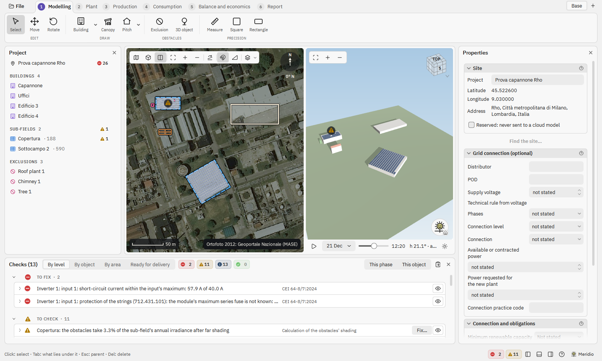
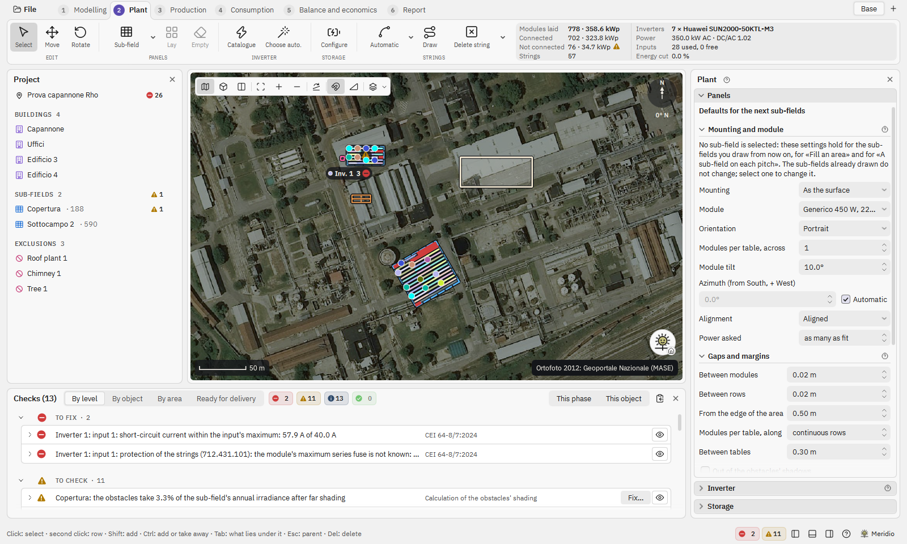
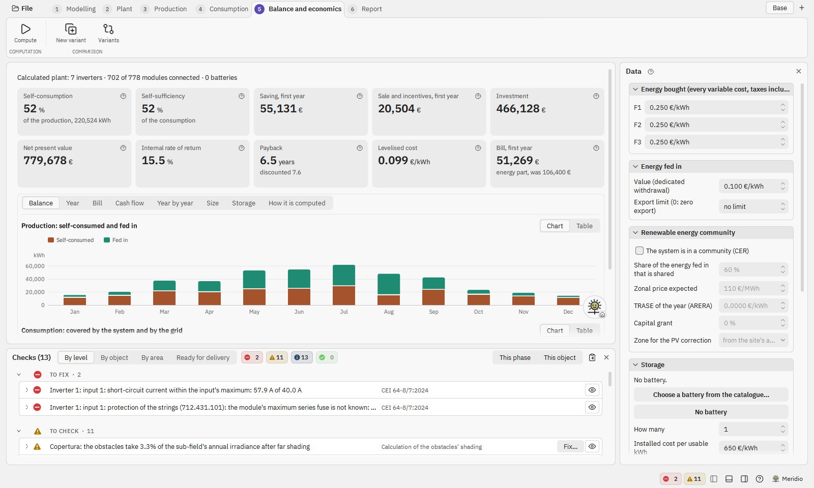

<p align="center">
  
</p>

<h1 align="center">Meridiana</h1>

<p align="center">
  Photovoltaic design on the desktop: site, building model, sun, module layout, strings, energy, economics and the
  Italian standards, in one program.
</p>

<p align="center">
  <a href="https://github.com/daniel-g-carrasco/meridiana/releases/latest">Download</a> ·
  <a href="docs/manuale/README.md">Manual (Italian)</a> ·
  <a href="docs/funzionalita.md">Functions and their state (Italian)</a> ·
  <a href="CHANGELOG.md">Changelog</a>
</p>

Meridiana is a desktop program for designing photovoltaic plants, for Windows and Linux. It is written in Python with
Qt 6.12 (PySide6, Qt Quick and Qt Quick 3D) and pvlib, and it is free software under the GPL-3.0-or-later.

It is made for designers who work with the Italian rules: CEI 0-21 and CEI 0-16 for the connection, CEI 64-8 and
CEI 82-25 for the plant and its strings, the fire brigade guidelines for the distances on the roof (DCPREV
14030/2025), the ARERA time bands for the consumption. The scope is the whole country: regional rules, where they
exist, are options and never the default. The interface is in English and Italian and follows the system's language;
the manual is in Italian.

> [!WARNING]
> Meridiana is in **alpha** (version 0.2). Every result carries its pedigree (the formula, the values, their source),
> but check the numbers before using them in a real project, and expect rough edges on large models.



<details>
<summary>More screenshots</summary>





</details>

The screenshots show the sample project in [`docs/quick/compat/fixtures`](docs/quick/compat/fixtures/README.md), in
English.

## What it does

The work follows six phases, shown as tabs at the top of the window. Each phase has its tools and its page of
results, with the plan and the 3D view side by side.

1. **Modelling.** The site from an address or coordinates, on the national orthophoto, OpenStreetMap or other public
   map sources. Buildings traced with CAD-like aids (guides, typed lengths and angles, rectangles, squaring,
   snapping), flat and pitched roofs, canopies for car parks, exclusions, 3D objects for the shadows (trees, vehicles,
   chimneys, tanks), and buildings imported from an architect's IFC model.
2. **Plant.** Panels first: sub-fields with their own mounting, tilt, orientation and margins, laid automatically or
   row by row by hand, keeping the margins, the fire brigade distances and the row pitch the sun asks for. Then the
   inverter (from the catalogue or sized by the program), the storage (AC or DC battery) and the strings: proposed,
   completed or drawn by hand, checked against CEI 64-8/7 and the inverter's limits, with optimizers where used.
3. **Production.** The hourly production of a PVGIS typical meteorological year with every loss on the way (pvlib):
   horizon, shading between rows and from obstacles and the IFC context, soiling, mismatch, cables, inverter
   efficiency and clipping. PVGIS's own estimate beside it, as a second opinion. Variants to compare layouts.
4. **Consumption.** The loads of the supply point: standard profiles, bills, measured curves, ARERA time bands.
5. **Balance and economics.** Self-consumption with or without a battery, savings, dedicated withdrawal, renewable
   energy communities, NPV, IRR, payback, LCOE.
6. **Report.** A technical report in PDF, ODT or DOCX, in the program's language, where every calculation shows its
   formula, its values and their origin, with the datasheets attached.

Across the phases:

- a **Checks** panel that lists what is not yet right against the standards and the plant's own limits;
- a **product catalogue** of modules, inverters, microinverters, optimizers and batteries: the NREL CEC lists, a
  curated set read from the manufacturers' datasheets, and a personal catalogue;
- **exchange with other tools**: IFC import (IFC2X3 and IFC4, the model as context and shadow), IFC4 export of the
  plant (also appended to the architect's file), DXF export of the plan, CSV of the hourly values, and the import of
  **PVsyst** projects and variants (read only);
- **Meridio**, an assistant that answers questions about the open project with a language model running on the
  computer (Ollama, LM Studio, llama.cpp and similar local servers) or, if you choose it and give your own key, with
  Claude;
- a **manual** inside the program (F1 on any field), in Italian, also readable in [`docs/manuale`](docs/manuale/README.md).

## Install

### Windows

Windows 10 or 11, 64 bit. Download `meridiana-setup-vX.Y.Z-windows-x64.exe` from the
[latest release](https://github.com/daniel-g-carrasco/meridiana/releases/latest) and run it.

- It installs for your user only, without administrator rights, and opens the `.mer` project files.
- Once a day the program asks GitHub whether a newer version is out (Settings > Privacy turns it off; Help > Check
  for updates asks at once). A new version is downloaded, checked against its SHA-256 and the project's signature,
  and installed only when both match.

> [!NOTE]
> The installer is not signed with an Authenticode certificate yet, so the first time Windows SmartScreen shows
> "Windows protected your PC": choose **More info**, then **Run anyway**. Each file of a release has a
> [minisign](https://jedisct1.github.io/minisign/) signature (`.minisig`): the key and the command that checks a
> download are in [CODE_SIGNING.md](CODE_SIGNING.md).

Settings stay in `%APPDATA%\Meridiana`, caches and recovery copies in `%LOCALAPPDATA%\Meridiana`; uninstalling
leaves them.

### Linux (Flatpak)

The Flatpak is not published in a repository yet. It is built from
[`build-aux/flatpak-quick`](build-aux/flatpak-quick/io.github.daniel_g_carrasco.meridiana.yaml) on the KDE runtime
6.11, with Qt 6.12 built into the package:

```bash
flatpak install --user flathub org.kde.Platform//6.11 org.kde.Sdk//6.11 org.flatpak.Builder
flatpak run org.flatpak.Builder --user --install --force-clean build-dir \
    build-aux/flatpak-quick/io.github.daniel_g_carrasco.meridiana.yaml
flatpak run io.github.daniel_g_carrasco.meridiana
```

In the Flatpak, Meridio speaks with the system's voice (the Kokoro voice is not packaged).

### From the sources

Python 3.12 or newer. Qt comes as three wheels (Essentials, Addons, Pdf), so the download stays small.

```bash
git clone https://github.com/daniel-g-carrasco/meridiana.git
cd meridiana
python3 -m venv .venv
.venv/bin/pip install -r requirements.txt     # on Windows: .venv\Scripts\pip ...
.venv/bin/python tools/compile_po.py          # the Italian catalogue (without it the window is in English)
.venv/bin/python bin/meridiana [PROJECT]
```

Optional parts, imported only when used: `ifcopenshell` for the IFC import and export, `anthropic` and `keyring` for
Meridio with Claude, `kokoro-onnx` for Meridio's natural voice (its model is downloaded separately).

`python -m meridiana.quick.package_check PROJECT OUT [--language en]` checks the window from end to end without a
screen and without touching your settings: it opens the project with a profile of its own, computes the year, shows
every phase, writes the report and says in `OUT/check.json` what it saw. The installed program runs the same check as
`Meridiana.exe -m meridiana.quick.package_check ...`.

> [!TIP]
> `meridiana --widgets` opens the previous Qt Widgets window. It is frozen (no new work goes there) and will be
> removed.

## What leaves the computer

Nothing about you, and never your project files. A few services receive only what they need to answer, each with its
own switch in Settings > Privacy:

| Service | What it receives | What for |
|---|---|---|
| Nominatim (OpenStreetMap) | the address you type | finding the site |
| PVGIS (European Commission, JRC) | the site's coordinates | weather year, horizon, reference estimate |
| Map tile servers | the area in view | the background map or orthophoto |
| GitHub (Windows program only) | a version request | checking for updates |
| Anthropic (only if you choose Claude for Meridio) | your questions and the project context you allow | the assistant's answers |

## Development

```bash
python -m ruff check src tests tools                     # lint (rules in pyproject.toml)
python tools/compile_po.py                               # the catalogues the tests load
python tools/compile_po.py --check                       # every string of the window has its translation
QT_QPA_PLATFORM=offscreen python tools/run_tests.py tests/nucleo     # one group of tests, offscreen
```

Run the groups one at a time: the window's groups open many windows, and two of them in parallel slow each other
down. The tests are grouped in packages under `tests/`:

| Group | What it covers |
|---|---|
| `nucleo/` | the core without Qt: geometry, sun, roofs, layout, rules, checks, IFC reading, project file |
| `calcoli/` | the energy pipeline against recorded PVGIS answers (`calcoli/riferimenti/`) |
| `formati/` | project and settings files of every format version, frozen (a new format adds a file, never rewrites one) |
| `quick/` | the Qt Quick window, offscreen: controls, plan, 3D view, pages, shell, Meridio, system rules |
| `widget/`, `finestra/` | the previous Qt Widgets window (frozen) |
| `esterni/` | what needs real PVsyst files or an idle machine; run only on request |

The CI ([`.github/workflows/test.yml`](.github/workflows/test.yml)) runs the lint and the suite on Linux offscreen on
every push. The Windows installer is built by [`build-aux/windows/build.ps1`](build-aux/windows/build.ps1)
(PyInstaller and Inno Setup); how versions are raised and releases are made is in
[`docs/progetto.md`](docs/progetto.md), section 4 (in Italian).

### Repository layout

```
bin/                    the launcher
src/meridiana/          the core, plain Python without Qt: coordinates, sun, roofs, layout, drawing aids, rules,
                        checks, project file, IFC and DXF; energy/ (weather, simulation, strings, storage,
                        economics), catalog/, pvsyst/ (reading PVsyst files), assistant/ (Meridio),
                        report_typst/ (the report)
src/meridiana/quick/    the Qt Quick window: the QML in qml/, the bridges to the core in backend/
src/meridiana/ui/       the previous Qt Widgets window, frozen
tests/                  the suite, by group
po/, locale/            translations (gettext)
data/                   fonts, icons, 3D models, ISTAT municipalities, Natural Earth outlines, Meridio's drawings
build-aux/              Windows (PyInstaller, Inno Setup) and Flatpak packaging
docs/                   the manual, the function list, the window's rules, design studies (mostly in Italian)
tools/                  helper scripts: catalogues, translations, icons, map coverage, PVsyst comparison, tests
```

## Data, services and credits

Meridiana stands on the work of others. The libraries (Qt for Python, pvlib, shapely, numpy, scipy, pandas,
matplotlib, pyqtgraph, Typst, IfcOpenShell, ezdxf), the fonts, the Lucide icons, the 3D models, the NREL CEC module
and inverter lists, the ISTAT municipalities, the Natural Earth outlines and every map source with its attribution
are listed with their licences in [ATTRIBUTIONS.md](ATTRIBUTIONS.md). The squaring of a traced outline is ported from
the OpenStreetMap editor iD. PVGIS, OpenStreetMap, OpenTopoMap and the national and regional orthophoto services are
used under their own terms: check them before a commercial use.

The references for the functions are PVsyst (what a PV design program computes), Aurora (the modelling and the use)
and PVGIS (the weather data). Comparisons with PVGIS and PVsyst are in
[`docs/validazione-pvgis.md`](docs/validazione-pvgis.md) and [`docs/validazione-pvsyst.md`](docs/validazione-pvsyst.md).

Meridiana is licensed under the GPL-3.0-or-later ([LICENSE](LICENSE)). Qt Quick 3D, which draws the 3D view, is
available under the GPL v3 or a commercial licence: the program as a whole is GPL v3.
