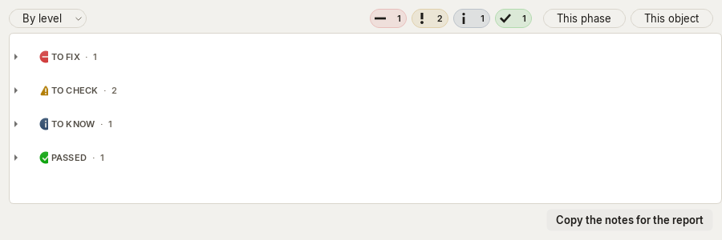
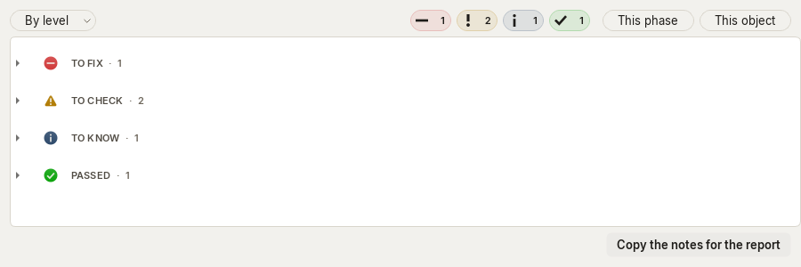
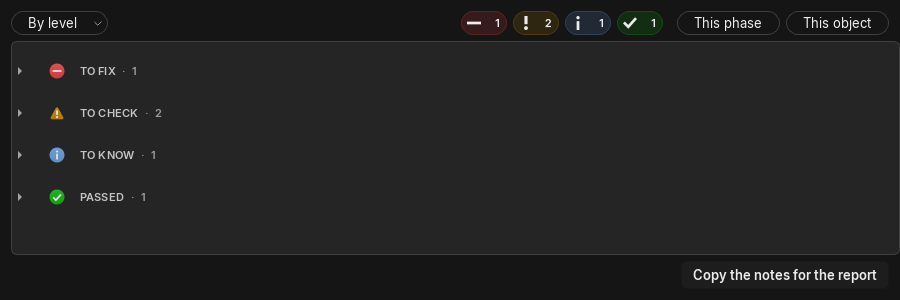
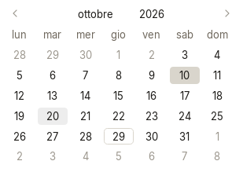
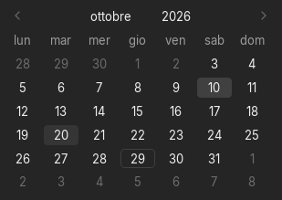
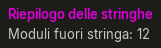
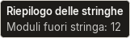

# Seguito UX condivisa del 29 ottobre 2026

Base Meridiana: `af17add`. Ambito: R222, R223, R232, R233 e R234. Modifiche di lavoro da integrare;
nessuna modifica a `docs/richieste.md`, al catalogo PO o al confezionamento da questo lotto.

## Esiti e riproduzioni

| Richiesta | Prima, riprodotto | Dopo, verificato |
|---|---|---|
| R222, gruppi Verifiche compressi | Espandendo tutto la colonna dei simboli era di 64 px; comprimendo tutto scendeva a 48 px e il testo copriva metà simbolo. | `SectionDelegate.sizeHint` riserva lo stesso rientro supplementare che `paint` usa per l'icona. La colonna resta a 64 px anche senza figli visibili. Nessuna larghezza fissa aggiunta alle Verifiche. |
| R232, hover calendario | Spostando il puntatore sul giorno 20 l'immagine della cella non cambiava. | Il calendario segue l'indice sotto il puntatore e aggiorna solo le celle coinvolte. Hover tenue anche sul giorno selezionato; oggi conserva l'anello. Date fuori intervallo e calendario disabilitato non ricevono il velo; i giorni disabilitati usano l'inchiostro disabilitato. |
| R233, tooltip ripetuto | Quattro chiamate con lo stesso testo sullo stesso controllo riformattavano quattro volte il tooltip. Il codice sostituiva il testo originale con HTML e invalidava il confronto con cui Qt decide di riusarlo. | Il testo originale resta invariato. Un documento separato gestisce impaginazione e pittura: quattro richieste producono un solo layout. Comparsa semplice senza animazione da riavviare; primo ritardo di 180 ms negli stili globale e dei gruppi. |
| R234, stile tooltip indipendente | Con `QLabel.setStyleSheet("color: ...")` senza selettore, il titolo del tooltip ereditava il colore della label. Riprodotto con magenta, sullo stesso schema usato dai riepiloghi sotto l'inverter. | Sfondo, bordo, inchiostro e carattere appartengono al tooltip. Il documento non eredita colore, sfondo o font della label: prova con label magenta, sfondo magenta e font da 24 px nei due temi. Le formattazioni intenzionali del testo ricco restano supportate. |

La correzione R222 è nel delegato condiviso `sections.py`, non in un'eccezione per le Verifiche. La correzione
R232 è in `day_picker.py`. R233-R234 sono in `popups.py`; i due stili espongono il ritardo di comparsa breve.
I documenti dei tooltip sono figli Qt della label: non si affidano a un attributo del wrapper Python, che Qt può
ricreare fra due eventi mentre l'oggetto C++ resta lo stesso.

## R223, confronto dell'animazione File

| Copia esaminata | Comportamento verificato |
|---|---|
| Meridiana corrente | `motion.enter`, due immagini opache, dissolvenza e piccolo spostamento orizzontale; durata normale 180 ms. Nessuna maschera crescente o effetto di opacità sull'albero dei widget. |
| Template Qt prima del riporto | `FilePage.unroll`, maschera verticale dall'alto; durata 180 ms. |
| Copia Qt di Quotario | Ancora la maschera verticale del template precedente, con la stessa durata. Letta e fotografata; non modificata da questo lotto. |
| Template Qt dopo il riporto | Lo stesso helper `Entrance`/`enter` di Meridiana e la variante predefinita `slide`. Il consumatore mantiene layout assestati e pittura attiva durante la cattura dello sfondo. |

La scelta segue la preferenza già espressa da Daniel per l'animazione corrente di Meridiana. Il riporto comprende
il contratto del chiamante: il vecchio `AppWindow` sospendeva gli aggiornamenti attorno all'apertura; ora la
modifica resta sincrona e i layout si assestano, con la pittura disponibile per la fotografia reale. Chiusure
precoci e riaperture non lasciano veli visibili. Con movimento ridotto la pagina compare intera subito.

`file_page.py`, `window.py` e `motion.py` di Meridiana sono stati letti per il confronto ma non modificati da
questo lotto. La riorganizzazione dei contenuti di File è un lavoro separato. I fotogrammi di confronto sono
stati acquisiti a 45 ms su una durata di 180 ms, senza composizioni o ridisegni artificiali; i contenuti delle
applicazioni sono diversi, quindi non si dichiara uguaglianza dei pixel fra prodotti.

## Fotografie guardate

Sono schermate reali dei widget Qt su piattaforma offscreen, nei due temi. Il controllo visivo conferma simboli
interi dopo il collasso, hover distinguibile senza cambiare selezione, tooltip senza colore ereditato e il nuovo
tipo di ingresso di File. Le immagini stanno in `docs/revisioni/foto/ux-condivisa-seguito-20261029`.

Per R223: `file-meridiana-current-{light,dark}.png`, `file-quotario-before-{light,dark}.png`,
`file-template-before-{light,dark}.png` e `file-template-after-{light,dark}.png`. Sono fotogrammi intermedi;
la sovrapposizione momentanea dei due testi appartiene alla dissolvenza, non allo stato finale della pagina.
Per il tema scuro delle Verifiche usare `checks-after-dark-R02.png`: include i token del delegato condiviso,
applicati dalla finestra reale e richiesti anche dalla prova del componente isolato.

## Verifiche e riporto

[V] Meridiana: 42 prove mirate verdi (`test_calendar_hover`, `test_tooltip_identity`, `test_tooltips`,
`test_checks_page`, `test_combo_popups`), 4,371 s. Sette prove sul difetto specifico sono verdi anche al 250%.
Le nuove regressioni sono state osservate fallire sul comportamento precedente prima della correzione.
Ruff sui file coinvolti e `git diff --check` superati.

[V] Template: riportati `sections`, `day_picker`, `popups`, i due stili, `motion.enter`, `file_page` e il
contratto del chiamante in `window`. Trentatré prove mirate verdi in 16,657 s; sette regressioni verdi anche al
250%. Fotografie e provenienza sono registrate anche nel modello.
`CLAUDE.md`, `README.md` e `docs/dal-template-gtk.md` preesistenti nel template sono preservati, verificati con SHA256.

Non sono state ripetute suite complete. Le prove offscreen dimostrano comportamento, pixel e ciclo di vita;
non misurano la fluidità del compositore del desktop reale né gli angoli DWM di Windows. Le fotografie
confermano il tipo di movimento e lo stato dei controlli, senza attribuire loro una misura di FPS.
